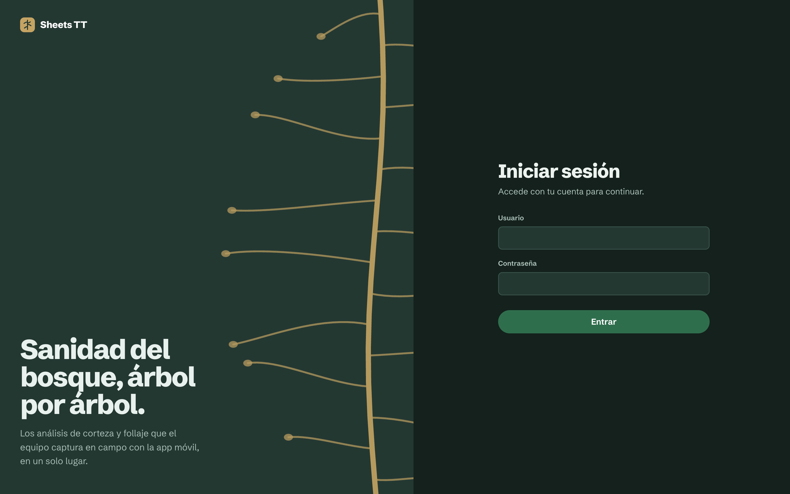
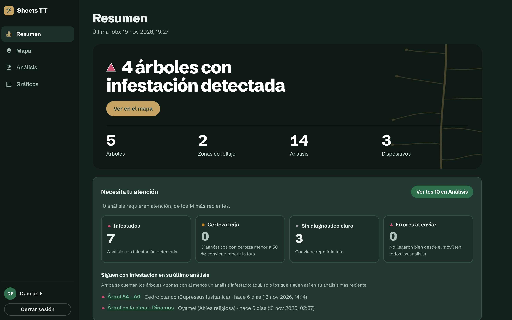
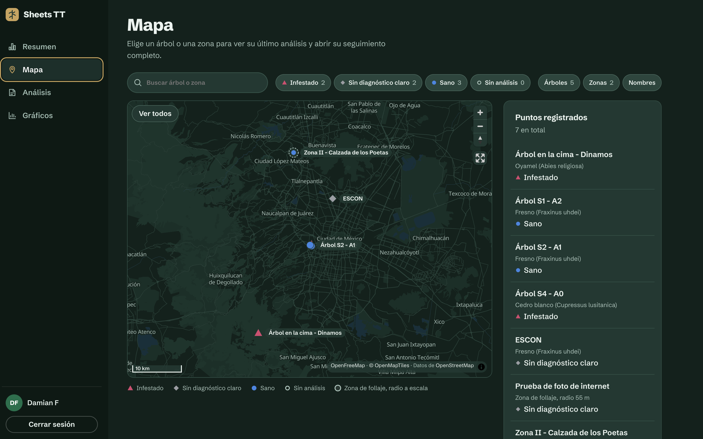
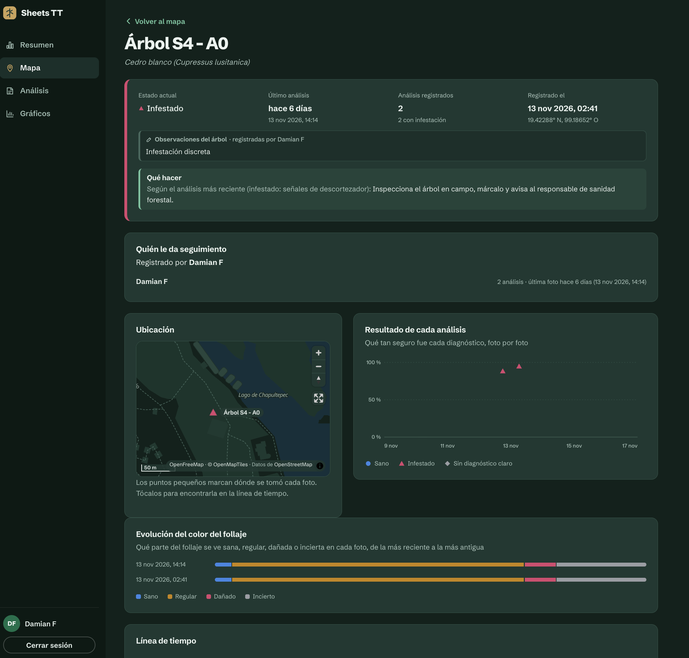
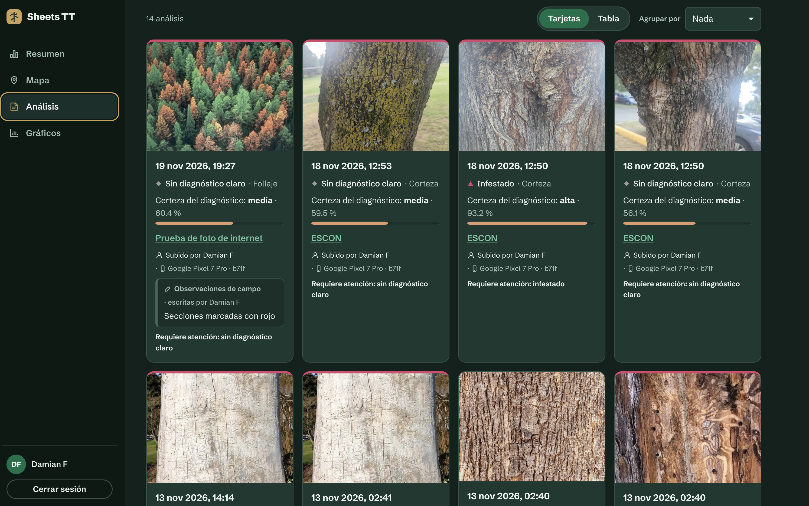
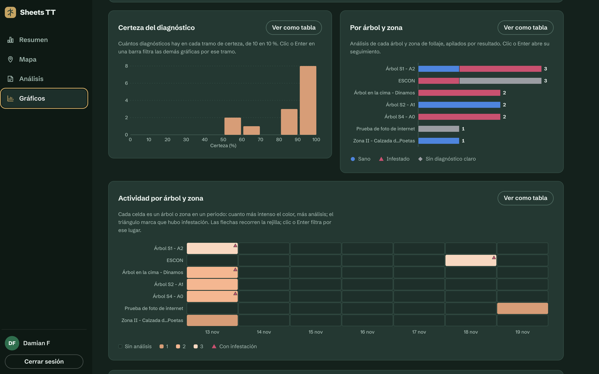
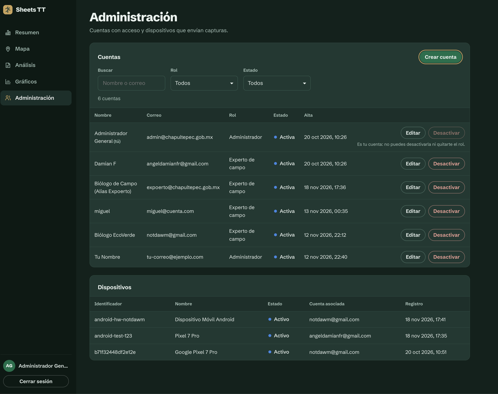
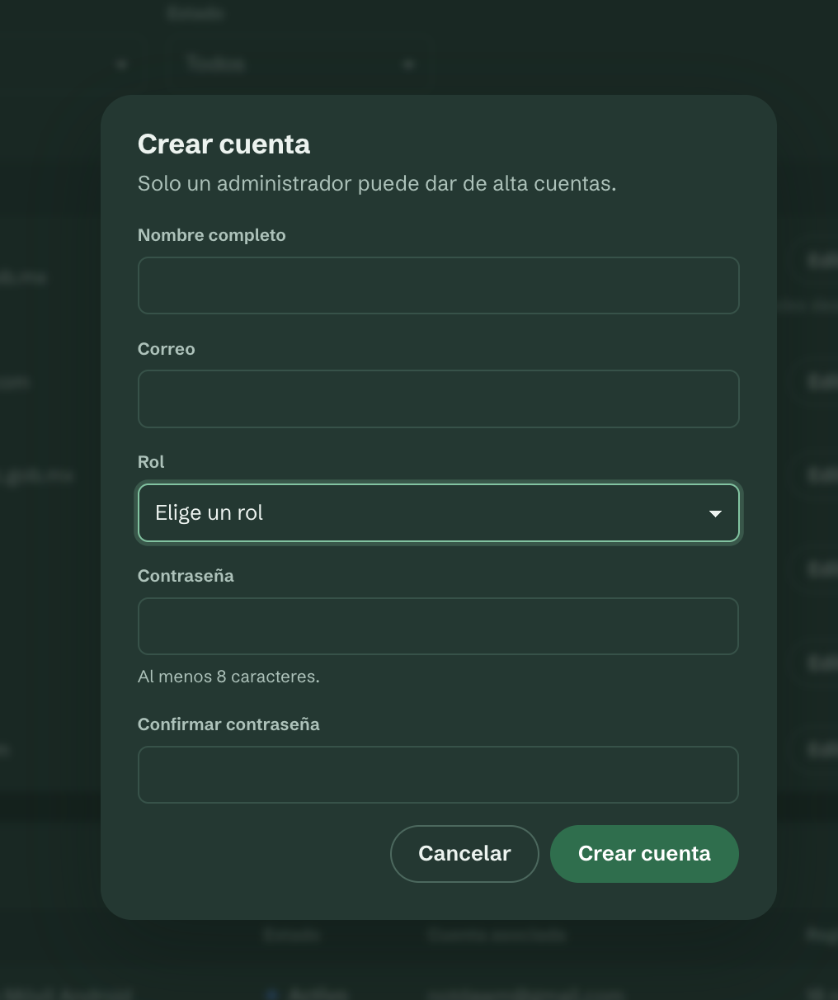

# Manual de Usuario — Plataforma Web EcoVerde (Sheets TT)

**Trabajo Terminal No. 2026-B161**  
*“Prototipo de sistema móvil de detección de insectos descortezadores en árboles mediante visión por computadora. Caso de estudio: Bosque de Chapultepec”*

---

## Ficha Técnica del Documento

| Campo | Información |
|---|---|
| **Sistema** | Plataforma Web EcoVerde (**Sheets TT**) |
| **Versión del Software** | `v1.0.0` (Build `2026-B161`) |
| **Versión del Manual** | `1.0` |
| **Fecha** | Noviembre de 2026 |
| **Público Objetivo** | **Experto de campo** (consulta y supervisión) y **Administrador** (gestión de cuentas) |
| **Institución** | Instituto Politécnico Nacional — Escuela Superior de Cómputo (ESCOM) |
| **Estándar de Referencia** | ISO/IEC/IEEE 26514:2022 y WCAG 2.1 / Material Design |
| **Autores** | Karime Calero Alvarez, Ángel Damián Franco Rayas, Miguel Ángel Gómez López |
| **Directores** | Ing. Ariel López Rojas, Dra. Vanessa Alejandra Camacho Vázquez |

### Control de Cambios

| Versión | Fecha | Descripción del Cambio | Responsable |
|---|---|---|---|
| `1.0` | Noviembre 2026 | Versión inicial del manual de usuario para la plataforma web `Sheets TT`. | Equipo TT 2026-B161 |

---

## Tabla de Contenido

1. [Introducción y Requisitos Mínimos](#1-introducción-y-requisitos-mínimos)
2. [Primeros Pasos (Acceso y Sesión)](#2-primeros-pasos-acceso-y-sesión)
3. [Anatomía de la Interfaz Web](#3-anatomía-de-la-interfaz-web)
4. [Guías Paso a Paso por Módulo](#4-guías-paso-a-paso-por-módulo)
   - [4.1 Consultar el Panel Principal (Resumen)](#41-consultar-el-panel-principal-resumen)
   - [4.2 Explorar el Mapa de Árboles y Zonas (Mapa)](#42-explorar-el-mapa-de-árboles-y-zonas-mapa)
   - [4.3 Consultar Seguimiento Individual de Árbol o Zona](#43-consultar-seguimiento-individual-de-árbol-o-zona)
   - [4.4 Filtrar Registros y Evidencias Fotográficas (Análisis)](#44-filtrar-registros-y-evidencias-fotográficas-análisis)
   - [4.5 Explorar Tendencias y Filtros Cruzados (Gráficos)](#45-explorar-tendencias-y-filtros-cruzados-gráficos)
   - [4.6 Gestionar Cuentas y Consultar Dispositivos (Administración — Solo Administrador)](#46-gestionar-cuentas-y-consultar-dispositivos-administración--solo-administrador)
5. [Resolución de Problemas (Troubleshooting) y Preguntas Frecuentes](#5-resolución-de-problemas-troubleshooting-y-preguntas-frecuentes)
6. [Glosario y Soporte Técnico](#6-glosario-y-soporte-técnico)

---

### Convenciones Gráficas Utilizadas

- **Negrita:** Nombres de botones, pestañas, enlaces o controles de la interfaz (por ejemplo, **Entrar**, **Aplicar filtros**, **Crear cuenta**).
- *Cursiva:* Nombres de secciones, campos de formulario o estados del sistema (por ejemplo, *Infestado*, *Activa*).
- `Código / Ruta`: Rutas URL, formatos o parámetros técnicos.
- **Notas y Advertencias:**
  > **Nota:** Aclaración operativa útil.
  > **Importante:** Regla de seguridad o restricción del sistema.

---

## 1. Introducción y Requisitos Mínimos

### 1.1 Propósito del Sistema

La plataforma web **Sheets TT** es el módulo de consulta, seguimiento histórico, visualización geográfica y administración del sistema **EcoVerde**. Permite revisar desde una computadora o navegador móvil la información sincronizada por los brigadistas desde la aplicación móvil Android en el Bosque de Chapultepec.

> **Importante:** La plataforma web es un entorno de **consulta, supervisión y administración de cuentas**. No permite editar ni borrar los registros operativos capturados en campo desde la aplicación móvil, garantizando la integridad histórica de la evidencia.

### 1.2 Roles de Usuario

| Rol | Secciones Disponibles | Capacidades Principales |
|---|---|---|
| **Experto de campo** | *Resumen*, *Mapa*, *Análisis*, *Gráficos* y *Seguimiento* | Consultar el estado general del bosque, mapas, historial completo, gráficas interactivas y fotografías de evidencia. |
| **Administrador** | Todas las anteriores + *Administración* | Además de la consulta general, puede crear, editar, activar y desactivar cuentas de usuario, asignar roles y consultar dispositivos vinculados. |

### 1.3 Requisitos Mínimos de Acceso

| Componente | Requisito |
|---|---|
| **Navegador compatible** | Google Chrome, Mozilla Firefox, Microsoft Edge o Safari (versiones recientes con soporte ES2022 y WebGL para el mapa). |
| **Conexión a internet** | Requerida de forma continua para consultar la base central en la nube y visualizar fotografías firmadas. |
| **Resolución de pantalla** | Diseño responsivo compatible con escritorio (1024 px o superior) y dispositivos móviles (360 px o superior). |
| **Credenciales** | Cuenta activa (*Experto de campo* o *Administrador*) creada previamente por un Administrador. |

---

## 2. Primeros Pasos (Acceso y Sesión)

### 2.1 Acceso e Inicio de Sesión

1. Abra su navegador web e ingrese a la dirección URL de la plataforma proporcionada por el administrador (`#/login`).
2. En el formulario **Iniciar sesión**, escriba su correo electrónico en el campo **Usuario**.
3. Escriba su **Contraseña**.
4. Haga clic en el botón **Entrar**.

**Resultado esperado:** El sistema valida sus credenciales y lo redirige automáticamente a la pantalla **Resumen**.

> **Nota sobre seguridad de sesión:**
> - La sesión web se resguarda únicamente mientras la pestaña del navegador permanezca abierta (`sessionStorage`) y el token de acceso tiene una vigencia de **1 hora** (`3,600 s`).
> - Al cerrar la pestaña o expirar el token, el sistema cerrará la sesión automáticamente por seguridad y mostrará la pantalla de inicio de sesión.

*Figura 1. Pantalla de inicio de sesión de la plataforma web Sheets TT.*

### 2.2 Cierre de Sesión

1. Ubique su nombre de usuario en la barra de navegación (parte inferior izquierda en escritorio, o superior derecha en móvil).
2. Haga clic en el botón **Cerrar sesión**.

---

## 3. Anatomía de la Interfaz Web

Una vez iniciada la sesión, la barra de navegación (lateral en escritorio y superior en dispositivos móviles) permanece visible en todas las vistas:

1. **Logotipo (Sheets TT):** Enlace directo para regresar a **Resumen**.
2. **Menú de Secciones:**
   - **Resumen:** Tablero principal con estado del bosque, alertas de atención, indicadores de 7 días y actividad reciente.
   - **Mapa:** Visor cartográfico interactivo con pines de árboles, zonas de follaje y filtros por estado.
   - **Análisis:** Buscador e historial completo de capturas en vista de tabla o tarjetas con acceso a fotografías.
   - **Gráficos:** Panel analítico interactivo con visualizaciones con filtro cruzado.
   - **Administración** *(solo visible para rol Administrador)*: Gestión de cuentas de usuario y tabla de dispositivos registrados.
3. **Bloque de Cuenta:** Muestra sus iniciales, nombre completo y el botón **Cerrar sesión**.

*Figura 2. Anatomía de la interfaz web y vista general de Resumen en Sheets TT.*

---

## 4. Guías Paso a Paso por Módulo

### 4.1 Consultar el Panel Principal (Resumen)

**Objetivo:** Obtener una vista rápida del estado sanitario del bosque, identificar análisis pendientes de revisión y revisar la actividad reciente.

**Pasos:**
1. Al iniciar sesión (o al hacer clic en **Resumen**), revise la tarjeta superior de **Estado del bosque**, que muestra:
   - El aviso principal de árboles o zonas con infestación detectada (y el botón **Ver en el mapa** si existen focos).
   - Los cuatro totales globales: **Árboles**, **Zonas de follaje**, **Análisis** y **Dispositivos**.
2. En el bloque **Necesita tu atención**, consulte los análisis recientes que requieren verificación (infestados, baja certeza o errores de envío) y haga clic en **Ver los X en Análisis** para revisarlos filtrados, o consulte la lista **Siguen con infestación en su último análisis**.
3. En **Últimos 7 días con datos**, compare el volumen de análisis, porcentaje de infestados, certeza promedio y fechas de la última foto y envío móvil frente a los 7 días previos.
4. En **Gráficas clave**, revise la actividad de los últimos 30 días y el top de lugares con mayor infestación; puede hacer clic en **Ver en Gráficos** para abrir el panel completo.
5. En **Actividad reciente** y **Todos los análisis**, consulte las últimas capturas (con enlace **Detalle**) y las barras segmentadas de resultados, color promedio del follaje y estado de envío móvil.

**Resultado esperado:** Panorama consolidado del monitoreo en campo con accesos directos a las secciones de análisis detallado.

---

### 4.2 Explorar el Mapa de Árboles y Zonas (Mapa)

**Objetivo:** Localizar geográficamente los árboles y zonas de follaje sincronizados, filtrar por estado sanitario y consultar su último análisis.

**Pasos:**
1. Haga clic en **Mapa** en la barra de navegación.
2. Utilice la barra superior de **Filtros del mapa**:
   - Escriba en **Buscar árbol o zona** para localizar un punto por nombre o especie (presione `Enter` para abrir el primer resultado).
   - Active o desactive los botones de estado: **Infestado**, **No determinado**, **Sano** y **Sin análisis**.
   - Filtre por tipo con **Árboles** y **Zonas**, o active/desactive **Nombres** para mostrar u ocultar las etiquetas sobre el mapa.
3. Navegue libremente sobre el mapa (zoom y arrastre) o haga clic en **Ver todos** para reencuadrar todos los puntos visibles.
4. Haga clic en un marcador del mapa o en un elemento de la lista lateral **Puntos registrados** para abrir su panel de detalle:
   - Consulte su estado actual, fecha de registro, coordenadas e historial de hasta 5 análisis recientes (con botón **Ver foto**).
   - Haga clic en **Ver seguimiento del árbol** (o **Ver seguimiento de la zona**) para abrir su historial completo.
   - Haga clic en **Ver todos los puntos** (o presione `Esc`) para cerrar el detalle.

**Resultado esperado:** Ubicación espacial clara de ejemplares sanos, indeterminados, infestados y polígonos de follaje a escala.

*Figura 3. Pantalla Mapa con filtros sanitarios, marcadores y lista lateral de puntos registrados.*

---

### 4.3 Consultar Seguimiento Individual de Árbol o Zona

**Objetivo:** Revisar la evolución temporal completa de un árbol o zona específica.

**Pasos:**
1. Ingrese desde el botón **Ver seguimiento del árbol / de la zona** en el *Mapa*, o haciendo clic en el nombre del árbol/zona desde *Resumen*, *Análisis* o *Gráficos*.
2. En la ficha superior **Estado actual**, consulte:
   - Estado más reciente, fecha del último análisis, total de análisis registrados, coordenadas y observaciones del lugar.
   - El recuadro **Qué hacer**, con la recomendación operativa según el resultado y certeza más recientes.
3. Revise las gráficas de seguimiento:
   - **Mini-mapa de capturas** y **Resultado de cada análisis** (certeza foto por foto; al hacer clic en un punto se resalta la captura correspondiente).
   - **Evolución del color del follaje** (cuando existan mediciones cromáticas, muestra las barras porcentuales cronológicas de tejido sano, regular, dañado e incierto).
4. En **Línea de tiempo**, filtre si lo desea por **Todos**, **Corteza** o **Follaje** y haga clic en **Ver foto** sobre cualquier evento para inspeccionar la evidencia fotográfica.
5. Para regresar, haga clic en **Volver al mapa**.

**Resultado esperado:** Trazabilidad cronológica completa de un ejemplar o zona hasta sus 200 análisis más recientes.

*Figura 4. Seguimiento individual de un ejemplar con ubicación, historial de certeza y evolución cromática.*

---

### 4.4 Filtrar Registros y Evidencias Fotográficas (Análisis)

**Objetivo:** Buscar inspecciones específicas por rango de fechas, tipo, resultado o estado de envío, y revisar su detalle completo y fotografía.

**Pasos:**
1. Haga clic en **Análisis** en la barra de navegación.
2. *(Opcional)* Ajuste los filtros superiores: **Desde**, **Hasta**, **Tipo de foto** (*Todos*, *Corteza*, *Follaje*), **Resultado** (*Todos*, *Sano*, *Infestado*, *No determinado*) y **Envío desde el móvil** (*Sincronizado*, *Pendiente*, *Error*). Luego haga clic en **Aplicar filtros** (o **Quitar filtros** para limpiar).
3. Utilice las **cajas de categoría** superiores para filtrar rápidamente en un clic los análisis cargados (por resultado, tipo, nivel de certeza o autor).
4. Elija el modo de visualización con los botones **Tarjetas** o **Tabla**, y seleccione si desea agrupar los registros en el selector **Agrupar por**.
5. Para revisar una inspección:
   - Haga clic en **Ver foto** para abrir únicamente la fotografía en ventana modal.
   - Haga clic en **Detalle** (o sobre una tarjeta) para abrir la ficha completa con fotografía, diagnóstico, **Qué hacer**, certeza, autor, dispositivo, coordenadas, porcentajes cromáticos y botones para navegar al análisis *Anterior* o *Siguiente* del mismo lugar.

> **Nota sobre evidencias fotográficas:** Por seguridad, las fotografías se cargan mediante enlaces temporales firmados válidos por **5 minutos**. Si permanece más tiempo en la vista y la imagen caduca, haga clic en **Reintentar** para generar un nuevo enlace.

**Resultado esperado:** Localización precisa de capturas históricas con inspección visual de la evidencia almacenada en la nube.

*Figura 5. Catálogo de Análisis en vista de tarjetas con fotografías de evidencia y metadatos.*

---

### 4.5 Explorar Tendencias y Filtros Cruzados (Gráficos)

**Objetivo:** Analizar visualmente hasta los 500 análisis más recientes mediante gráficas interactivas vinculadas entre sí.

**Pasos:**
1. Haga clic en **Gráficos** en la barra de navegación.
2. Use la barra superior para acotar **Desde**, **Hasta**, **Tipo** y **Árbol o zona**, o navegue en el tiempo con los botones **Anterior**, **Acercar**, **Alejar**, **Siguiente** y **Restablecer**.
3. Interactúe directamente con cualquiera de las 4 gráficas (cada selección filtra automáticamente las demás gráficas y la lista inferior):
   - **Serie temporal:** Arrastre sobre la gráfica (*pincel*) para seleccionar un rango de fechas o haga clic en un resultado para aislarlo.
   - **Histograma de certeza:** Haga clic en una barra de porcentaje (`0–100%`) para filtrar por rango de confianza.
   - **Gráfica por lugar:** Compare conteos por árbol o zona y haga clic para abrir o filtrar un punto.
   - **Mapa de calor:** Identifique concentración de análisis por lugar y periodo.
4. Revise los chips activos debajo de los filtros para quitar selecciones individuales, o consulte la lista paginada inferior (`20` registros por página) para abrir el seguimiento de cualquier punto.

> **Nota:** Los filtros aplicados se reflejan en la URL del navegador, por lo que puede copiar la dirección para compartir exactamente la misma vista con otro integrante del equipo.

**Resultado esperado:** Análisis visual dinámico con filtrado cruzado en tiempo real.

*Figura 6. Panel analítico Gráficos con visualizaciones interactivas con filtro cruzado.*

---

### 4.6 Gestionar Cuentas y Consultar Dispositivos (Administración — Solo Administrador)

**Objetivo:** Dar de alta, editar, activar o desactivar cuentas de usuario y consultar los dispositivos móviles asociados.

**Requisitos previos:** Haber iniciado sesión con una cuenta de rol **Administrador**.

#### A. Buscar y Filtrar Cuentas
1. Haga clic en **Administración** (o **Admin** en móvil) en la barra de navegación.
2. Use los filtros **Buscar** (*Nombre o correo*), **Rol** (*Administrador*, *Experto de campo*) y **Estado** (*Activa*, *Desactivada*), o haga clic en **Quitar filtros**.

#### B. Crear una Cuenta Nueva
1. Haga clic en el botón **Crear cuenta**.
2. Complete los campos obligatorios: **Nombre completo**, **Correo**, **Rol** (*Experto de campo* o *Administrador*), **Contraseña** (mínimo `8` caracteres) y **Confirmar contraseña**.
3. Haga clic en **Crear cuenta**.

#### C. Editar, Desactivar o Activar una Cuenta
1. En la fila del usuario correspondiente, haga clic en **Editar** para modificar su nombre, correo, rol o asignar una **Contraseña nueva** (déjela vacía si desea conservar la actual) y presione **Guardar cambios**.
2. Para suspender o rehabilitar el acceso de un usuario, haga clic en **Desactivar** (o **Activar**) y confirme la acción en el cuadro de diálogo.

> **Importante:**
> - Desactivar una cuenta bloquea de inmediato su acceso a la plataforma web y la sincronización desde la app móvil, pero **conserva intactos** todos sus árboles y análisis históricos.
> - Por seguridad operativa, no es posible desactivar su propia cuenta ni retirarse su propio rol de Administrador. Si modifica su propio correo, la sesión se cerrará automáticamente para volver a entrar con el nuevo correo.

#### D. Consultar Dispositivos Asociados
1. Desplácese a la sección inferior **Dispositivos**.
2. Consulte el **Identificador** único, **Nombre**, **Estado**, **Cuenta asociada** y fecha de **Registro** de cada teléfono autorizado.

**Resultado esperado:** Control centralizado de accesos, roles y trazabilidad de dispositivos vinculados al sistema.

*Figura 7. Módulo de Administración: gestión de cuentas de usuario y tabla de dispositivos vinculados.*

*Figura 8. Formulario modal para dar de alta una nueva cuenta de usuario.*

---

## 5. Resolución de Problemas (Troubleshooting) y Preguntas Frecuentes

### 5.1 Diagnóstico de Errores Comunes

| Síntoma o Mensaje | Causa Probable | Solución Recomendada |
|---|---|---|
| No puedo iniciar sesión o aparece error de credenciales | Correo o contraseña incorrectos, o cuenta desactivada. | Verifique su correo y contraseña. Si su cuenta fue desactivada, solicite al Administrador reactivarla. |
| La sesión se cerró repentinamente y regresó al login | Expiró el token de seguridad (`1 hora`), cerró la pestaña o cambiaron su correo/rol. | Inicie sesión nuevamente con su correo y contraseña vigentes. |
| `«Hasta» no puede ser anterior a «Desde»` en *Análisis* | La fecha final seleccionada es menor a la inicial. | Corrija el rango de fechas de modo que **Desde** sea anterior o igual a **Hasta**. |
| La fotografía de evidencia no carga o indica enlace caducado | El enlace temporal firmado de S3 (`5 minutos`) venció o hubo falla de red. | Haga clic en **Reintentar** o cierre y vuelva a abrir la vista de foto para generar un enlace nuevo. |
| No aparece la pestaña **Administración** | La cuenta actual tiene rol *Experto de campo*. | Solo las cuentas con rol *Administrador* tienen acceso al módulo administrativo. |
| El mapa aparece en blanco o muy lento | Navegador sin soporte WebGL o conexión lenta al servidor de teselas. | Use una versión actualizada de Chrome, Edge o Firefox con aceleración gráfica habilitada. |

### 5.2 Preguntas Frecuentes (FAQ)

- **¿Por qué no veo un árbol o foto que acabo de tomar en la app móvil?**  
  Los registros aparecen en la plataforma web únicamente después de que la aplicación móvil los sincroniza con internet. Verifique en la app móvil (*Alertas* -> *Cola de Sincronización*) que el estado sea *Sincronizado*.

- **¿Puedo eliminar o modificar un análisis desde la web?**  
  No. Por diseño de integridad (`RN-53`), la plataforma web es exclusivamente de consulta y supervisión.

- **¿Puedo ver la plataforma web desde el celular?**  
  Sí. La interfaz web es responsiva y se adapta a pantallas móviles; sin embargo, para trabajo en campo sin conexión debe usarse la aplicación móvil Android **EcoVerde**.

---

## 6. Glosario y Soporte Técnico

### 6.1 Glosario Breve

- **Análisis cromático (HSV):** Desglose porcentual de coloración (sano, regular, dañado, incierto) calculado en campo para corteza o follaje.
- **Certeza / Confianza:** Probabilidad estimada por el modelo de clasificación (`0–100%`). Las capturas de corteza con certeza $\le 75\%$ se clasifican como *No determinado*.
- **Filtro cruzado (Crossfilter):** Comportamiento en *Gráficos* donde seleccionar un dato en una visualización actualiza automáticamente todas las demás.
- **URL firmada (SigV4):** Enlace temporal de 5 minutos que permite ver de forma segura fotografías privadas almacenadas en Amazon S3.
- **Zona de follaje:** Área circular de monitoreo de copa/dosel identificada por un punto central y un radio en metros.

### 6.2 Canales de Soporte

Para reportar incidencias técnicas o solicitar gestión de cuentas administrativas, comuníquese con el equipo responsable del **Trabajo Terminal 2026-B161** (ESCOM — IPN):

- **Correo de soporte técnico:** `mgomezl1801@alumno.ipn.mx`
- **Correos alternos del equipo:** `kcaleroa1900@alumno.ipn.mx`, `afrancor1900@alumno.ipn.mx`
