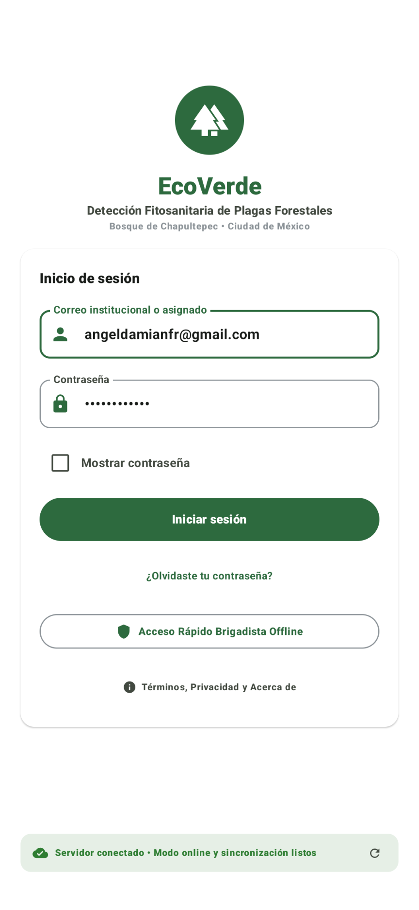
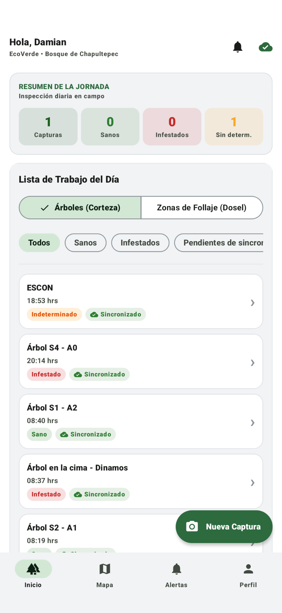
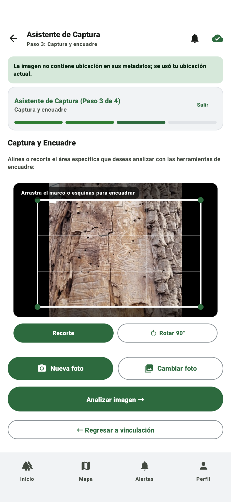
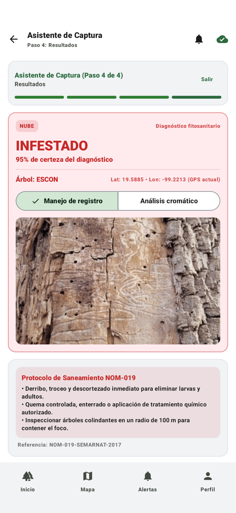
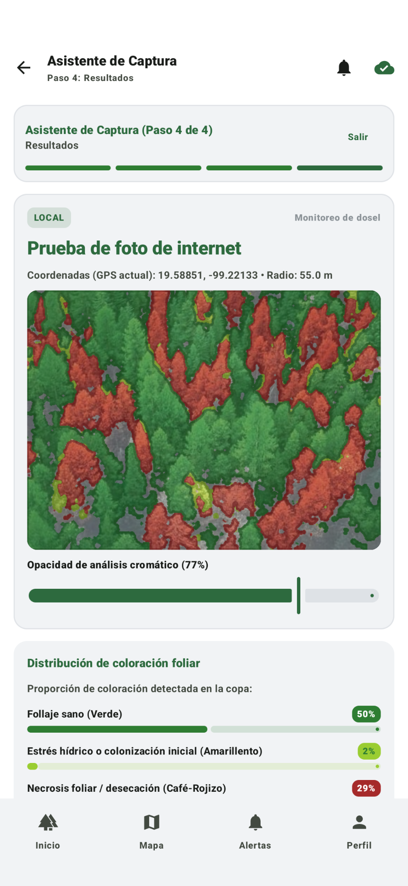
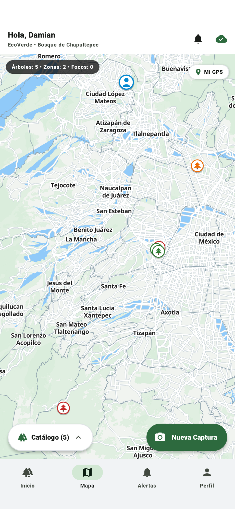
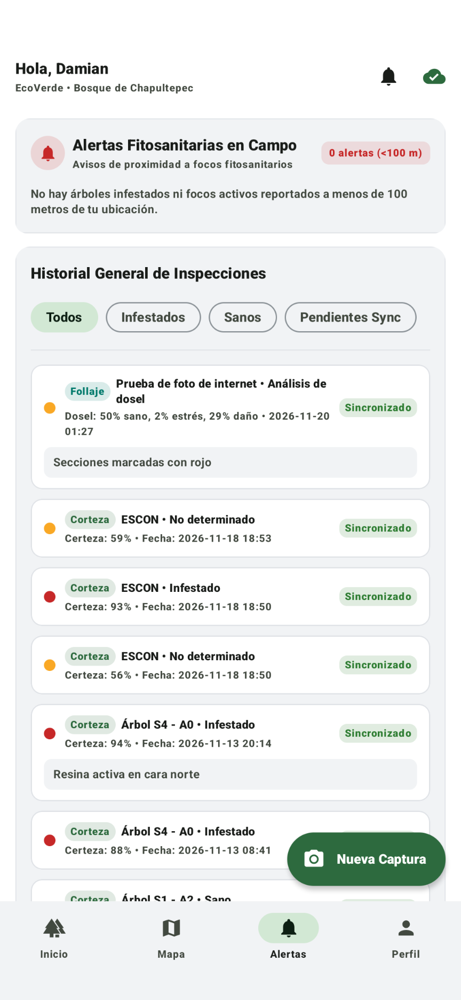

# Manual de Usuario — Aplicación Móvil EcoVerde

**Trabajo Terminal No. 2026-B161**  
*“Prototipo de sistema móvil de detección de insectos descortezadores en árboles mediante visión por computadora. Caso de estudio: Bosque de Chapultepec”*

---

## Ficha Técnica del Documento

| Campo | Información |
|---|---|
| **Sistema** | EcoVerde — Aplicación Móvil Android |
| **Versión del Software** | `v1.0.0` (Build `2026-B161`) |
| **Versión del Manual** | `1.0` |
| **Fecha** | Noviembre de 2026 |
| **Público Objetivo** | Experto de campo (biólogos, técnicos forestales y guardabosques) |
| **Institución** | Instituto Politécnico Nacional — Escuela Superior de Cómputo (ESCOM) |
| **Estándar de Referencia** | ISO/IEC/IEEE 26514:2022 y Material Design 3 |
| **Autores** | Karime Calero Alvarez, Ángel Damián Franco Rayas, Miguel Ángel Gómez López |
| **Directores** | Ing. Ariel López Rojas, Dra. Vanessa Alejandra Camacho Vázquez |

### Control de Cambios

| Versión | Fecha | Descripción del Cambio | Responsable |
|---|---|---|---|
| `1.0` | Noviembre 2026 | Versión inicial del manual de usuario para la aplicación móvil `v1.0.0`. | Equipo TT 2026-B161 |

---

## Tabla de Contenido

1. [Introducción y Requisitos Mínimos](#1-introducción-y-requisitos-mínimos)
2. [Primeros Pasos (Onboarding)](#2-primeros-pasos-onboarding)
3. [Anatomía de la Interfaz Principal](#3-anatomía-de-la-interfaz-principal)
4. [Guías Paso a Paso por Módulo](#4-guías-paso-a-paso-por-módulo)
   - [4.1 Consultar Resumen de Jornada y Catálogo de Trabajo (Inicio)](#41-consultar-resumen-de-jornada-y-catálogo-de-trabajo-inicio)
   - [4.2 Realizar una Nueva Captura y Análisis Fitosanitario (Asistente de 4 Pasos)](#42-realizar-una-nueva-captura-y-análisis-fitosanitario-asistente-de-4-pasos)
   - [4.3 Consultar el Mapa Forestal Sin Conexión (Mapa)](#43-consultar-el-mapa-forestal-sin-conexión-mapa)
   - [4.4 Revisar Alertas, Historial y Sincronizar Registros (Alertas)](#44-revisar-alertas-historial-y-sincronizar-registros-alertas)
   - [4.5 Gestionar Perfil, Datos Locales y Cerrar Sesión (Perfil)](#45-gestionar-perfil-datos-locales-y-cerrar-sesión-perfil)
5. [Resolución de Problemas (Troubleshooting) y Preguntas Frecuentes](#5-resolución-de-problemas-troubleshooting-y-preguntas-frecuentes)
6. [Glosario y Soporte Técnico](#6-glosario-y-soporte-técnico)

---

### Convenciones Gráficas Utilizadas

Para facilitar la lectura de los procedimientos en este manual, se utilizan las siguientes convenciones:

- **Negrita:** Nombres de botones, pestañas, tarjetas o elementos interactivos de la interfaz (por ejemplo, **Iniciar sesión**, **Nueva Captura**).
- *Cursiva:* Nombres de pantallas, campos de formulario o estados del sistema (por ejemplo, *SANO*, *Pendiente*).
- `Código / Ruta`: Valores técnicos, formatos de archivo o mensajes de referencia.
- **Notas y Advertencias:**
  > **Nota:** Información útil o aclaración operativa.
  > **Importante:** Restricción o regla obligatoria para evitar pérdida de datos o diagnósticos incorrectos.

---

## 1. Introducción y Requisitos Mínimos

### 1.1 Propósito del Sistema

**EcoVerde** es una aplicación móvil nativa para Android diseñada como herramienta de apoyo en campo para el monitoreo fitosanitario de árboles frente a plagas de insectos descortezadores (*Dendroctonus spp.*, *Ips spp.*, *Hylesinus sp.* y *Phloeosinus sp.*), alineada con la norma **NOM-019-SEMARNAT-2017**.

La aplicación opera bajo un enfoque **Offline-First**: permite capturar fotografías, ejecutar diagnósticos mediante visión por computadora directamente en el teléfono, consultar el mapa vectorial del Bosque de Chapultepec y guardar los registros localmente sin necesidad de conexión a internet. Cuando el dispositivo recupera conectividad (Wi-Fi o datos móviles), la información se sincroniza de forma automática con el servidor en la nube.

> **Importante:** Los resultados generados por la aplicación constituyen una herramienta de apoyo diagnóstico en campo y **no sustituyen** el dictamen taxonómico de laboratorio ni autorizan por sí solos el derribo de arbolado sin verificación física del especialista.

### 1.2 Alcance de Usuarios

La aplicación móvil está destinada exclusivamente al rol **Experto de campo** (brigadistas, técnicos forestales y biólogos). Las cuentas con rol *Administrador* operan únicamente desde la plataforma web complementaria.

### 1.3 Requisitos Mínimos y Recomendados del Dispositivo

| Componente | Requisito Mínimo | Requisito Recomendado |
|---|---|---|
| **Sistema Operativo** | Android 8.0 Oreo (API 26) | Android 12 a Android 15 (API 31–35) |
| **Memoria RAM** | 3 GB | 6 GB a 12 GB |
| **Almacenamiento Libre** | 500 MB disponibles | 2 GB a 4 GB disponibles |
| **Cámara** | 8 MP con **Autoenfoque (AF)** | 12 MP o superior con estabilización óptica |
| **Ubicación** | Receptor GPS/GNSS físico integrado | GPS de doble frecuencia (L1 + L5) |
| **Gráficos** | Soporte OpenGL ES 2.0 / 3.0 | GPU compatible con OpenGL ES 3.0+ |
| **Conectividad** | Opcional en campo (requerida para sincronización) | Wi-Fi o datos móviles para envío a la nube |

> **Importante:** No utilice dispositivos Android Go con menos de 2.5 GB de RAM, tabletas "Solo Wi-Fi" sin chip GPS ni cámaras de enfoque fijo (*fixed-focus*), ya que impiden enfocar la corteza a corta distancia (15–30 cm) u obtener coordenadas satelitales en zonas boscosas.

---

## 2. Primeros Pasos (Onboarding)

### 2.1 Instalación

1. Obtenga el paquete instalador oficial (`EcoVerde-v1.0.0.apk`) proporcionado por el administrador del proyecto.
2. En su dispositivo Android, abra el archivo `.apk` desde el gestor de archivos y autorice la instalación de aplicaciones de origen conocido si el sistema lo solicita.
3. Una vez finalizada la instalación, toque el ícono **EcoVerde** en el cajón de aplicaciones.

### 2.2 Permisos Requeridos

Para operar correctamente en campo, la aplicación solicitará los siguientes permisos del sistema:

- **Ubicación precisa (`ACCESS_FINE_LOCATION` / `ACCESS_COARSE_LOCATION`):** Necesaria para registrar las coordenadas GPS de cada árbol o zona, centrar el mapa y emitir alertas de proximidad de 100 metros.
- **Cámara (`CAMERA`):** Necesaria para fotografiar corteza y follaje directamente desde el asistente de captura.
- **Fotos, archivos multimedia y ubicación en medios (`READ_MEDIA_IMAGES` / `ACCESS_MEDIA_LOCATION`):** Necesarios para importar imágenes desde la galería y extraer sus coordenadas EXIF originales.
- **Notificaciones (`POST_NOTIFICATIONS`):** Opcional en Android 13+, utilizada para avisos de proximidad a focos de infestación.

> **Nota:** Seleccione **"Mientras la app está en uso"** o **"Permitir"** cuando aparezcan los diálogos del sistema.

### 2.3 Inicio de Sesión

No existe autorregistro público en la aplicación; su cuenta debe ser dada de alta previamente por un Administrador en la plataforma web.

**Pasos:**
1. Abra la aplicación **EcoVerde**.
2. En el formulario *Inicio de sesión*, ingrese su **Correo institucional o asignado**.
3. Ingrese su **Contraseña** (puede marcar la casilla **Mostrar contraseña** para verificar lo escrito).
4. Toque el botón **Iniciar sesión**.

> **Nota sobre uso sin conexión:**
> - El indicador inferior muestra si el servidor está en línea (*"Servidor conectado"*) o en modo local (*"Modo local listo"*).
> - Si ya inició sesión previamente en ese teléfono o se encuentra en una zona sin señal durante una jornada autorizada, puede usar el botón **Acceso Rápido Brigadista Offline** para ingresar inmediatamente con la sesión local de campo.
> - La sesión móvil permanece abierta hasta que usted decida cerrarla manualmente.

  
   
  <em>Figura 1. Pantalla de inicio de sesión e indicador de conectividad de EcoVerde.</em>

### 2.4 Recuperación de Contraseña

Si olvidó su contraseña (requiere conexión a internet):

1. En la pantalla de inicio de sesión, toque **¿Olvidaste tu contraseña?**.
2. Ingrese su **Correo institucional** y toque **Enviar código de recuperación**.
3. Revise su correo e ingrese el **Código de 24 horas** en la pantalla *Restablecer contraseña*.
4. Escriba y confirme su **Nueva contraseña** (mínimo 8 caracteres, incluyendo números y caracteres especiales).
5. Toque **Actualizar contraseña**.

> **Nota:** El código de recuperación es de **un solo uso**, caduca a las **24 horas** y se permite un máximo de **3 solicitudes cada 30 días**.

---

## 3. Anatomía de la Interfaz Principal

Al iniciar sesión, accederá a la vista principal organizada bajo lineamientos de **Material Design 3**:

1. **Barra Superior (Top App Bar):**
   - A la izquierda muestra el saludo personalizado (*"Hola, [Nombre]"*) y el área de trabajo (*"EcoVerde • Bosque de Chapultepec"*).
   - A la derecha cuenta con dos accesos rápidos: el ícono de **Campana** (abre el centro de alertas con indicador numérico) y el ícono de **Nube** (indica si hay registros pendientes y ejecuta la sincronización manual al tocarlo).
2. **Área de Contenido Central:** Muestra la sección seleccionada actualmente.
3. **Botón Flotante Principal (Extended FAB — Nueva Captura):** Botón verde en la esquina inferior derecha visible desde *Inicio*, *Mapa*, *Alertas* y *Perfil* para iniciar en un toque el asistente de inspección.
4. **Barra de Navegación Inferior (Bottom Navigation Bar):** Permite cambiar entre las cuatro secciones principales:
   - **Inicio:** Resumen de la jornada y lista de trabajo (árboles y zonas).
   - **Mapa:** Mapa vectorial offline con pines de árboles, zonas y anillos sanitarios de 100 m.
   - **Alertas:** Avisos de proximidad en campo, historial general y cola de sincronización.
   - **Perfil:** Datos de la cuenta, resumen operativo, información normativa, limpieza local y cierre de sesión.

  
   
  <em>Figura 2. Anatomía de la pantalla principal (Inicio) de EcoVerde.</em>

---

## 4. Guías Paso a Paso por Módulo

### 4.1 Consultar Resumen de Jornada y Catálogo de Trabajo (Inicio)

**Objetivo:** Visualizar los conteos del día en curso y consultar o editar el detalle de un árbol o zona registrada.

**Requisitos previos:** Haber iniciado sesión en la aplicación.

**Pasos:**
1. Toque la pestaña **Inicio** en la barra de navegación inferior.
2. En la tarjeta superior **RESUMEN DE LA JORNADA**, revise los cuatro indicadores del día actual (`00:00` a `23:59` hrs):
   - **Capturas:** Total de fotografías analizadas hoy.
   - **Sanos:** Ejemplares dictaminados sin signos de plaga (verde).
   - **Infestados:** Ejemplares con indicios de plaga detectados (rojo).
   - **Sin determ.:** Capturas cuya certeza no superó el 75% (ámbar).
3. Desplácese a la tarjeta **Lista de Trabajo del Día** y elija la sub-pestaña **Árboles (Corteza)** o **Zonas de Follaje (Dosel)**.
4. (Opcional) Filtre los elementos usando los chips horizontales: **Todos**, **Sanos**, **Infestados** o **Pendientes de sincronizar**.
5. Toque cualquier árbol o zona para abrir su vista de detalle (*Detalle del ejemplar*). Desde ahí puede:
   - Consultar su **ESTADO ACTUAL** y **Ficha Técnica del Árbol** (coordenadas GPS).
   - Tocar **Ver en mapa** para ubicarlo en el visor cartográfico.
   - Escribir notas en **Observaciones de campo** y tocar **Guardar observaciones**.
   - Revisar el **Historial de la jornada para este ejemplar** o iniciar una **Nueva captura en este árbol**.
   - Eliminar el registro local mediante el ícono de **Papelera** (requiere confirmación).

**Resultado esperado:** Visualización actualizada del avance diario y acceso al historial individual de cada ejemplar o zona.

---

### 4.2 Realizar una Nueva Captura y Análisis Fitosanitario (Asistente de 4 Pasos)

**Objetivo:** Capturar o importar una fotografía de corteza o follaje, vincularla a un árbol o zona y obtener el diagnóstico fitosanitario y cromático.

**Requisitos previos:** Permisos de cámara/galería y ubicación otorgados. Para imágenes desde galería: formato `JPG`, `JPEG`, `PNG`, `WEBP`, `BMP` o `HEIC`, peso máximo `10 MB` y resolución mínima de `300 × 300 px`.

**Pasos:**

1. **Iniciar el asistente:** Toque el botón flotante **Nueva Captura** (o **Nueva captura en este árbol** desde el detalle de un ejemplar).
2. **Paso 1 — Modalidad:** Seleccione el tipo de inspección:
   - **Corteza de árbol** (*Inspección individual*): Fotografía cercana al tronco (15–30 cm) para clasificación con inteligencia artificial (*Sano* / *Infestado* / *No determinado*) más análisis cromático.
   - **Follaje / Dosel** (*Monitoreo de dosel*): Fotografía amplia o aérea de copa para cuantificar proporciones de coloración foliar.
3. **Paso 2 — Vinculación territorial:**
   - Seleccione **Árbol existente** (o **Zona existente**) para buscar y elegir un registro previo, **o bien** seleccione **Dar de alta nuevo** (o **Dar de alta nueva zona**).
   - Si registra un árbol nuevo, escriba el **Identificador / Nombre del árbol** (ej. *Fresno 01 - Calzada*) y elija la **Especie forestal** (*Fresno*, *Cedro blanco*, *Pino* u *Oyamel*). Las coordenadas GPS actuales se asignarán automáticamente.
   - Toque **Capturar foto →**.
4. **Paso 3 — Captura y encuadre:**
   - Toque **Abrir cámara** para tomar la fotografía en el sitio, o **Desde galería** para seleccionar una imagen almacenada.
   - *(Opcional)* Use el editor interactivo para arrastrar las esquinas del recuadro y enfocar la zona de interés, toque **Rotar 90°** si requiere orientar la imagen, **Recorte** para confirmar el área seleccionada o **Restaurar a original** para deshacer.
   - Toque **Analizar imagen →**.
5. **Paso 4 — Revisar resultados y guardar:**
   - **Si eligió Corteza:** Observe la tarjeta superior de diagnóstico (`SANO`, `INFESTADO` o `NO DETERMINADO`), el porcentaje de certeza y la etiqueta de ejecución (*LOCAL* u *NUBE*).
     - En la pestaña **Manejo de registro**, consulte el protocolo recomendado conforme a la **NOM-019-SEMARNAT-2017**.
     - En la pestaña **Análisis cromático**, deslice la barra **Opacidad de máscara** sobre la foto para resaltar zonas dañadas o exudados de resina y revise las barras porcentuales.
   - **Si eligió Follaje:** Revise las coordenadas de la toma, ajuste la barra **Opacidad de análisis cromático** sobre la fotografía y consulte los porcentajes de *Follaje sano (Verde)*, *Estrés hídrico (Amarillento)*, *Necrosis foliar (Café-Rojizo)* y *Área no determinada / fondo*.
   - *(Opcional)* Agregue notas en **Observaciones de esta captura**.
   - Toque **Guardar y finalizar** (o **Guardar zona y finalizar**). Si la imagen salió borrosa o la confianza fue $\le 75\%$ (*NO DETERMINADO*), toque **Repetir captura**.

**Resultado esperado:** El análisis queda almacenado localmente en el teléfono con estado *Pendiente* (o se sincroniza automáticamente en segundo plano si hay internet) y actualiza el *Resumen de la Jornada*.

  
   
  <em>Figura 3. Paso 3 del asistente de captura: editor interactivo de recorte y encuadre.</em>

  
   
  <em>Figura 4. Paso 4 del asistente de captura (Corteza): dictamen fitosanitario y protocolo NOM-019.</em>

  
   
  <em>Figura 5. Paso 4 del asistente de captura (Follaje / Dosel): máscara cromática y distribución de coloración foliar.</em>

---

### 4.3 Consultar el Mapa Forestal Sin Conexión (Mapa)

**Objetivo:** Ubicar geográficamente los árboles inspeccionados, zonas de follaje y anillos de riesgo sanitario sin usar datos móviles ni Wi-Fi.

**Requisitos previos:** Haber otorgado permiso de ubicación (para visualizar su posición actual).

**Pasos:**
1. Toque la pestaña **Mapa** en la barra de navegación inferior.
2. En la parte superior izquierda verá el resumen rápido (*Árboles • Zonas • Focos*); en la parte superior derecha toque **Mi GPS** para centrar la cámara en su ubicación actual.
3. Identifique los elementos en el mapa:
   - **Pines de árboles:** Verde (*Sano*), Rojo (*Infestado*) y Ámbar (*No determinado*).
   - **Anillos ámbar de 100 m:** Radio sanitario trazado alrededor de cada árbol *Infestado* conforme a la NOM-019.
   - **Círculos rojos:** Focos activos de infestación ($\ge 3$ árboles infestados en $\le 1,000\text{ m}^2$).
   - **Polígonos verdes:** Zonas de follaje monitoreadas.
4. Toque cualquier pin de árbol para abrir su ficha inferior (*Bottom Sheet*) con la distancia en metros desde su posición y los botones **Ir en mapa**, **Ver Detalle** y **+ Nueva Captura**.
5. También puede tocar la pastilla **Catálogo** (abajo a la izquierda) para desplegar la lista completa de árboles registrados y centrar cualquiera con **Ir al mapa**.

**Resultado esperado:** Visualización fluida y 100% offline del arbolado georreferenciado y áreas de alerta sanitaria.

  
   
  <em>Figura 6. Pestaña Mapa sin conexión con marcadores fitosanitarios, ubicación GPS y acceso al catálogo.</em>

---

### 4.4 Revisar Alertas, Historial y Sincronizar Registros (Alertas)

**Objetivo:** Consultar alertas de proximidad a focos activos, filtrar el historial de capturas y enviar manualmente los registros pendientes al servidor.

**Pasos:**
1. Toque la pestaña **Alertas** en la barra de navegación inferior (o el ícono de **Campana** en la barra superior).
2. **Alertas Fitosanitarias en Campo:** Revise si existen árboles infestados o focos activos a menos de **100 metros** de su posición GPS. Toque **Ver en Mapa** o **Centrar** para ubicarlos.
3. **Historial General de Inspecciones:** Use los filtros **Todos**, **Infestados**, **Sanos** o **Pendientes Sync** y toque cualquier fila para inspeccionar la fotografía, resultados cromáticos y editar observaciones.
4. **Cola de Sincronización:**
   - Verifique cuántos registros están en estado *Pendiente* o *Error*.
   - Cuando cuente con Wi-Fi o datos móviles, toque el botón **Sincronizar ahora** / **Sincronización manual** (o el ícono de nube en la barra superior) para enviar los registros pendientes y descargar el catálogo actualizado.

> **Nota:** La aplicación también programa automáticamente el envío en segundo plano en cuanto detecta conexión a internet, conservando la fecha, hora y coordenadas originales de captura.

**Resultado esperado:** Todos los registros locales cambian su estado a *Sincronizado* y quedan disponibles para consulta en la plataforma web.

  
   
  <em>Figura 7. Pestaña Alertas: avisos de proximidad sanitaria (&lt;100 m) e historial general de inspecciones.</em>

---

### 4.5 Gestionar Perfil, Datos Locales y Cerrar Sesión (Perfil)

**Objetivo:** Consultar datos del brigadista, verificar el identificador del dispositivo, limpiar datos locales o cerrar sesión de forma segura.

**Pasos:**
1. Toque la pestaña **Perfil** en la barra de navegación inferior.
2. Revise su **nombre**, **rol**, **correo**, **modelo e ID del dispositivo** y el bloque **Resumen Operativo** (*Capturas*, *Árboles*, *Pendientes*).
3. Si desea consultar las políticas de uso de datos e imágenes, toque **Términos, Privacidad y Acerca de**.
4. *(Solo cuando sea necesario)* Para liberar el almacén local del teléfono, toque **Borrar datos locales** y confirme en el diálogo.
   > **Importante:** Sincronice sus registros pendientes **antes** de borrar los datos locales; esta acción elimina permanentemente los registros no sincronizados del dispositivo.
5. Para salir de su cuenta, toque **Cerrar sesión**.

**Resultado esperado:** Cierre seguro de la sesión regresando a la pantalla de inicio de sesión.

---

## 5. Resolución de Problemas (Troubleshooting) y Preguntas Frecuentes

### 5.1 Diagnóstico de Errores Comunes

| Síntoma o Mensaje | Causa Probable | Solución Recomendada |
|---|---|---|
| *Credenciales incorrectas* / *Cuenta desactivada* | Correo mal escrito, contraseña errónea o usuario deshabilitado. | Verifique sus datos o use **¿Olvidaste tu contraseña?**. Si la cuenta está desactivada, contacte al Administrador. |
| *El dispositivo no está autorizado para esta cuenta* | El teléfono fue desvinculado o está asignado a otro usuario en la web. | Solicite al Administrador asociar o habilitar su dispositivo desde el panel web. |
| Resultado aparece como **NO DETERMINADO** | Certeza del modelo $\le 75\%$ por foto borrosa, poca luz o exceso de sombra/fondo. | Toque **Repetir captura**, acerque la cámara a **15–30 cm** del tronco, enfoque bien la corteza y evite contraluces. |
| *El recorte debe medir al menos 300×300 px* / *Imagen no válida* | La foto o el área recortada es muy pequeña, excede `10 MB` o tiene un formato no soportado. | Amplíe el cuadro de recorte o use una imagen en `JPG`, `JPEG`, `PNG`, `WEBP`, `BMP` o `HEIC` de hasta `10 MB` y $\ge 300\times 300\text{ px}$. |
| *Ubicación no disponible* o GPS impreciso | Permiso denegado, GPS apagado o cobertura satelital obstruida. | Active la **Ubicación** del teléfono, salga momentáneamente a un claro del dosel o verifique los permisos de la app. |
| Registros permanecen en *Pendiente* o *Error* | Sin conexión a internet o interrupción temporal durante la subida. | Al volver a una zona con señal estable, abra **Alertas** y toque **Sincronizar ahora**. |
| La app no se instala o se cierra al abrir cámara/mapa | Android inferior a 8.0, menos de 3 GB de RAM, sin OpenGL ES 2.0/3.0 o almacenamiento $< 300\text{ MB}$. | Libere espacio de almacenamiento (deje al menos 500 MB libres), cierre otras aplicaciones o use un equipo compatible. |

### 5.2 Preguntas Frecuentes (FAQ)

- **¿Puedo usar EcoVerde en el bosque sin señal celular?**  
  Sí. La captura, el diagnóstico de corteza con TensorFlow Lite, el análisis de color HSV con OpenCV, el mapa vectorial y las alertas de proximidad de 100 m funcionan **100% sin internet**.

- **¿Se pierde la fecha u hora real si sincronizo horas después?**  
  No. La aplicación guarda la fecha, hora UTC y coordenadas GPS exactas del momento de la captura y las conserva intactas al sincronizar.

- **¿Por qué no puedo crear mi cuenta desde la aplicación móvil?**  
  Por seguridad operativa (regla de negocio `RN-01`), únicamente el Administrador puede dar de alta nuevas cuentas desde la plataforma web.

---

## 6. Glosario y Soporte Técnico

### 6.1 Glosario Breve

- **Insectos descortezadores:** Escarabajos (*Dendroctonus*, *Ips*, *Hylesinus*, *Phloeosinus*) que perforan la corteza y excavan galerías en el tejido subcortical, interrumpiendo el flujo de nutrientes del árbol.
- **Corteza / Fuste:** Capa externa del tronco inspeccionada de forma individual a corta distancia (15–30 cm) para detectar grumos de resina, aserrín u orificios.
- **Follaje / Dosel:** Copa o conjunto de hojas/acículas observadas de forma amplia para detectar cambios cromáticos (verde sano, clorosis amarillenta o necrosis café-rojiza).
- **Foco de infestación (NOM-019):** Zona con 3 o más árboles infestados dentro de una superficie de $1,000\text{ m}^2$, con un radio de alerta sanitaria de **100 metros** alrededor.
- **Offline-First:** Modo de operación que guarda y procesa todo localmente en el dispositivo sin depender de conexión en tiempo real.
- **Análisis cromático (HSV):** Medición porcentual de tonalidades asociadas a tejido sano, estrés/resina fresca y daño/necrosis.

### 6.2 Canales de Soporte

Para reportar incidencias técnicas, solicitar alta de cuentas o autorización de nuevos dispositivos, comuníquese con el equipo responsable del **Trabajo Terminal 2026-B161** (ESCOM — IPN):

- **Correo de soporte técnico:** `mgomezl1801@alumno.ipn.mx`
- **Correos alternos del equipo:** `kcaleroa1900@alumno.ipn.mx`, `afrancor1900@alumno.ipn.mx`
